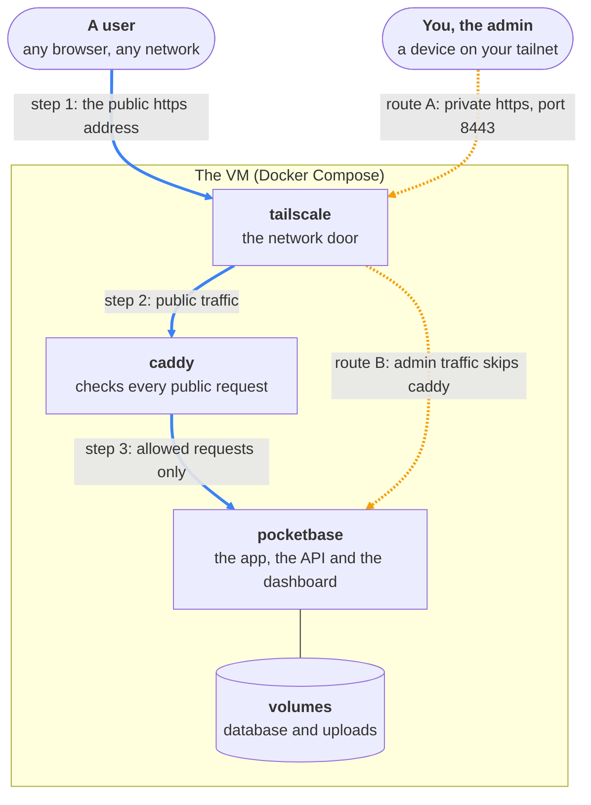
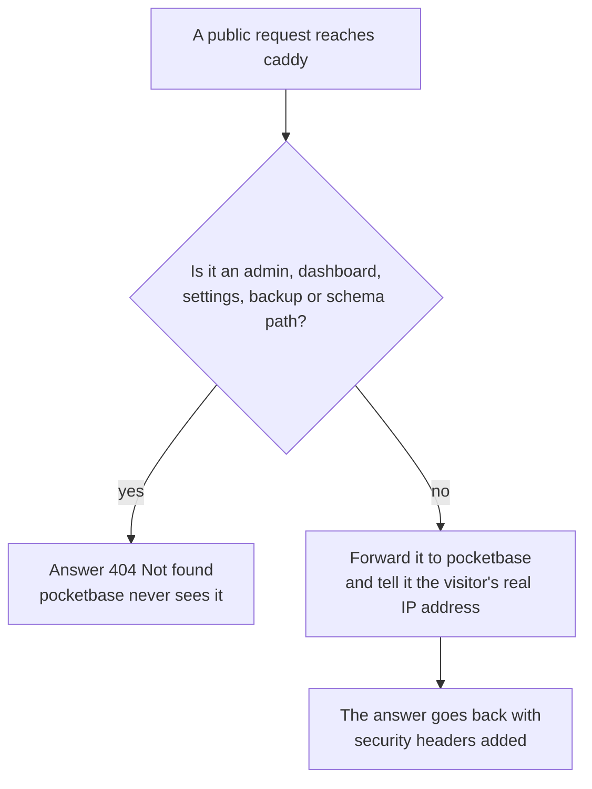
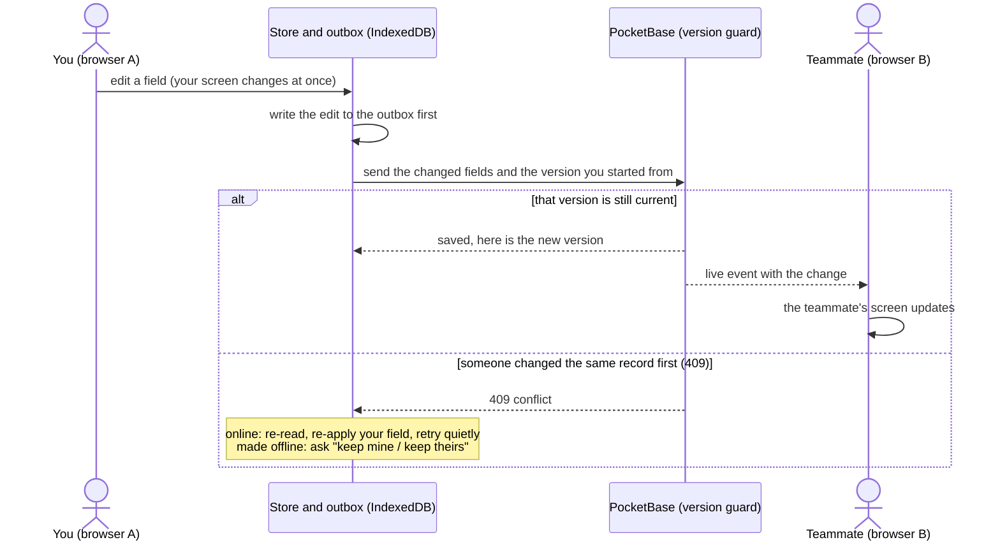

# How KWNTO fits together

A map of the whole system in one place, for someone who has to read or change it by hand. It does not repeat the detailed pages; it says what the parts are, how a request travels, and which page to open next. Start with the [design](../superpowers/specs/2026-11-11-kwnto-design.md) for *what* the product does, then come back here for *how* it is built.

## The running system

Two kinds of people reach the system, and each has **their own route**. Read the picture from the person's side.

- **Blue, thick (steps 1 to 3): everything a user does.** Signing in, loading the app's own files, opening a project, saving an edit, uploading, opening a share link, the live updates. The app asks for `/`, meaning "the address this page came from", so a user's browser can only ever reach the **public address**, and that always passes through Caddy. A user cannot reach PocketBase directly.
- **Orange, dashed (routes A and B): you, the admin.** Port 8443 is open only to devices on your tailnet and goes **straight to PocketBase**, so you can open the dashboard (`/_/`). It is not published on the internet.

Caddy is the checkpoint on the user's route:

- **One backend, no separate app server.** PocketBase stores data in SQLite, enforces access, runs our server code, serves the API, streams live changes and serves the built web app (from the `kwnto-web` volume).
- **Four services** in `compose.prod.yaml`: `web` (builds the app once and exits; `Exited (0)` is normal), `pocketbase`, `caddy` and `tailscale` (publishes the site with Funnel). Data lives in volumes, so rebuilding a container never deletes it.
- **Caddy also limits request sizes.** It sets the security headers and the largest body it accepts. Details: [deployment](../admin/deployment.md).
- **Updates and backups** are scripts in `deploy/`: `update.sh` (backs up first), `backup-now.sh`, `restore.sh`.
- **In development there is no Caddy:** the Vite dev server forwards `/api` to PocketBase on port 8090, which is why the same `/` address works on your laptop.

## The code, in three layers

| Layer | Where | What it is |
|---|---|---|
| The app | `frontend/src/features/*` | Screens and their logic, one folder per feature: `editor`, `share`, `player`, `teams`, `comments`, `presence`, `trash`, `auth`, `shell`, `projects`, `projectFile` |
| The door | `frontend/src/backend/` | The **only** place that imports PocketBase. One `backend` object with an area per concern (`auth`, `teams`, `content`, `media`, `shares`, `realtime`, ...). It maps raw records to plain types and turns errors into `BackendError` |
| The server | `backend/` | `pb_migrations/` (collections and their **access rules**), `pb_hooks/` (server code: `*.pb.js` hooks, helpers in `lib/`), the Docker image |

Rules to keep in your head, enforced by lint: only the door imports PocketBase; 300 lines per file; no `any`; PocketBase rules default to "superusers only" (deny by default).

### Inside the app

- **State is plain data plus pure functions.** The editor's `ContentState` is records by id; functions such as `liveNodes`, `choicesOf`, `nodeMarkers` read it and never change it (`features/editor/model/`). That is why most logic has small unit tests.
- **One Zustand store per concern** (`editorStore`, `useMediaStore`, the sync store). Screens read through selectors and change content only through the store's `edits`.
- **Routes** are hash routes parsed in `features/shell/routes.ts`: `#/` (teams), `#/team/<id>`, `#/project/<id>[/chapter/<id>]`, `#/s/<token>` (share link), `#/verify/..`, `#/reset/..`.
- **The canvas** is React Flow. `Canvas.tsx` draws only what is in view, so a card that is scrolled off-screen is not in the page at all.

### Inside the server

- **Rules** (in migrations) say who may list, view, create, update and delete each collection. **Hooks** add logic rules cannot express: the version guard on every content write, sign-in lockout, upload checks and quota, share-link routes, project import and export, trash and retention jobs, mails, the admin's incident controls. Each hook file starts with a comment saying what it does and which design section it implements.
- **Scheduled jobs** run inside PocketBase: nightly backup 02:00 UTC (keeps 7), log retention 03:00, trash purge 03:30, an hourly storage check.
- **Security is enforced here, never in the browser.** The browser is treated as untrusted. [security.md](../security.md) lists the controls and the incident runbook.

## How a change travels (the short version)

1. A screen calls the store (`edits.update(...)`). The screen changes at once.
2. The edit goes into an **outbox** in the browser's IndexedDB, then is sent one at a time through the door with the **version** the record had when you started editing.
3. The server's version guard accepts it only if that version is still current; otherwise it answers **409**. Online, the client retries quietly; for an edit made while offline, a real conflict asks you "keep mine / keep theirs".
4. The server then streams the change to everyone watching the project over the live connection, and their screens update.

The full story, with every edge case, is in [the editor notes: How an edit travels](editor.md#how-an-edit-travels). The reasons for the design are in [decision 0002](../decisions/0002-realtime-spike.md) (measured: two people editing different fields of one record lost edits, so every write carries a version).

## Words you will meet

| Word | Meaning |
|---|---|
| **Door** | `frontend/src/backend/`: the one module that talks to PocketBase |
| **Rule / hook** | A rule decides *who may* touch a collection; a hook is server code that runs on a request or on a schedule |
| **Version guard / 409** | Every write names the version it started from; a stale write is refused with HTTP 409 |
| **Outbox** | The browser's list of edits waiting to be sent (IndexedDB), so nothing is lost offline |
| **Overlay** | Laying your waiting edits over whatever the server sends, so your unsent change stays visible |
| **Live node / chapter** | Not in the trash (and, for a node, in a chapter that is not in the trash) |
| **Choice** | A connection from a node whose target may be empty (written, not linked yet) |
| **Start node** | The node Player Mode and the markers begin from; the first node made, unless changed |
| **Share link** | A token that opens one project as view, comment or edit; live or a frozen snapshot; revocable |
| **Project file** | The JSON export/import format; also what a share link's viewer reads (`docs/developer/project-file.md`) |
| **Funnel / tailnet** | Tailscale's public address for the site, and the private network the admin uses |

## Where to read next

- The editor's model, store and sync: [editor.md](editor.md).
- Collections, hooks, guarded writes, the door's methods: [backend.md](backend.md).
- Styling tokens: [styling.md](styling.md). Tests: [testing.md](testing.md).
- Running it and fixing it: [maintaining.md](maintaining.md).
