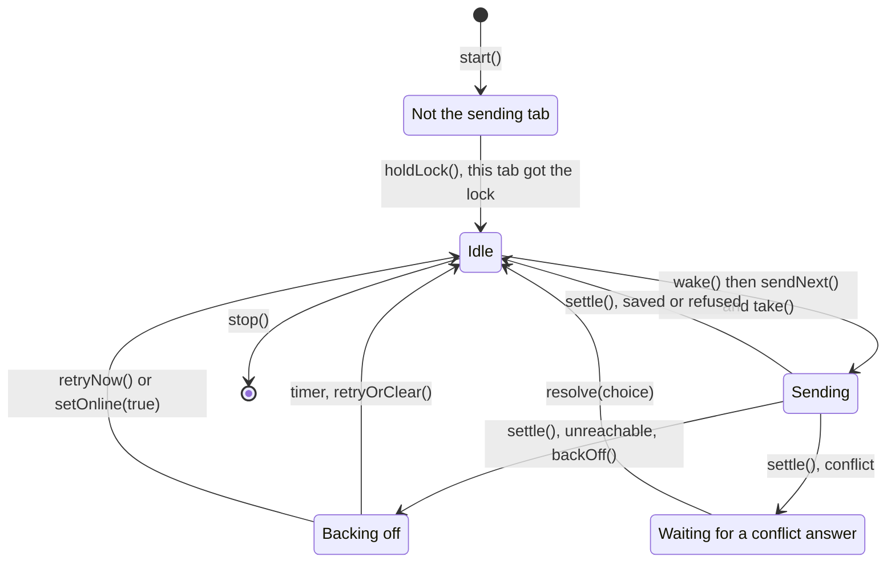

# The editor: model, store and canvas

The editor's state is plain data with pure functions over it, plus one store that loads a project, applies edits at once, sends them through the backend door and applies teammates' live changes. Screens read and change content only through the store. Plan: [editor core](../superpowers/plans/2026-11-14-editor-core/README.md), Task 8.

## Where things are

| File (in `frontend/src/features/editor/`) | What |
|---|---|
| `model/ids.ts` | `newId()`: a 15-character `a-z0-9` id from `crypto.getRandomValues`. The browser makes every new record's id (undo re-creates a record with its id) |
| `model/sortOrder.ts` | Decimal sort order (decision D4): `sortOrderBetween`, `renumber`, `byOrder`, and `placeAt` and `insertAt` for moving and inserting in a list |
| `model/state.ts` | `ContentState` (records by id) and the "live" views over it |
| `model/remote.ts` | `applyRemote`: a teammate's change applied to the state |
| `store/editorStore.ts` | `editorStore`, `useEditor(selector)`; composes the two below |
| `store/editorSession.ts` | `open` and `close` |
| `store/editorEdits.ts` | `create`, `update`, `remove` with rollback |
| `model/fixtures.ts` | Record builders for tests only |

## The state

`ContentState` holds the open project, its settings, and the chapters, nodes, script lines, cues and connections **by id**, trashed ones included (undo and the trash need them). The views never mutate:

- `liveChapters`: not trashed, by `position` then id.
- `isLiveNode` / `liveNodes`: the node exists, is not trashed **and its chapter exists and is not trashed**. Trashing a chapter therefore hides its nodes without touching them.
- `liveConnections`: both ends are live nodes. A trashed node leaves no dangling edge.
- `linesOf` / `cuesOf`: of one node, by `sortOrder` then id.

## Sort order

Lines, cues and chapter tabs carry a decimal order. Inserting between two neighbours takes the midpoint; at an end it takes the neighbour plus or minus 1. When the midpoint is no longer strictly between the neighbours (after about 50 halvings in one gap) `sortOrderBetween` returns `null` and `placeAt` / `insertAt` answer with `{ kind: 'renumber', orders }`: the whole list as 1, 2, 3, ... The caller sends one update per record in that case.

## How an edit travels

1. A screen calls `update(kind, id, changes)` (or `create`, `remove`) on the store (through `edits`, so it lands in the undo history).
2. The store changes `content` at once and raises `saving`, then hands the edit to the **outbox** (`store/editorEdits.ts`): `sync.add` with the version and the **values** of the fields before the edit (`baseVersion`, `baseValues`), and for lines, cues and connections the whole record after it (`snapshot`, used to re-create a record a teammate deleted). The edit's promise stays pending.
3. `sync/syncEngine.ts` writes the entry to IndexedDB first (`indexedDbOutbox.ts`, database `kwnto-outbox`; `add` resolves after the transaction completed). The first storage call is made at once, so text flushed on `pagehide` reaches IndexedDB before the page goes. An update joins the last waiting entry of the same record (`planAdd` in `sync/outbox.ts`); a remove cancels the waiting work on that record. Only the tab holding the Web Lock `kwnto-sync-<userId>` merges and sends; another tab only appends.
4. The engine sends entries in `seq` order, one request at a time, through the door (`backend.content`). The door sends the changed fields with the entry's `baseVersion` and handles a 409 by itself (online edits retry silently, up to 20 times). An entry leaves the outbox only when the server answered. Then `hooks.saved` resolves the edit's promise `true`, and the saved record replaces the local one **only if its version is higher**.
5. `unreachable` puts the entry back (marked `offline`), the engine goes offline and tries again after 1, 2, 4 ... 30 seconds; the window's `online` event tries at once. A refusal (`invalid`, `forbidden`, other) moves the entry to the failed list (`failed` store) and `hooks.refused` takes the fields of that edit back (a later edit of another field stays); the promise resolves `false` and `error` holds the message. After a page reload there is no copy in memory, so the server's copy is fetched (`door.get`) and shown.
6. An entry marked `offline` (made while offline, or whose send found the server unreachable) that meets a 409 is checked by `classifyConflict` (design D4): a real conflict stops the engine and opens `ConflictDialog`; `Keep mine` re-sends it on the server's version, `Keep theirs` drops the conflicting fields and still sends the fields of the entry that did not conflict (`hooks.theirs` puts the server's record on screen).
7. The server's change event for our own save comes back through the subscription. Its version is not newer than the local copy, so `applyRemote` ignores it. A teammate's change has a higher version and is applied; a delete drops the record; an event of another project is ignored. **Every record that arrives from the server is laid over again with the waiting entries (`overlay`)**, so my waiting edit stays on top of a teammate's change.

### Several tabs (D9)

Every tab keeps the promises of its own edits, so the answers must reach every tab. The tab that sends tells all tabs through the BroadcastChannel (`syncAnswers.ts`, `TabMessage`): `saved`, `refused` and `theirs` per `seq`, and `saved` with no record for an edit that a later remove cancelled (it never reached the server, which is what the person asked for). A tab that does not send also shows what the sending tab tells it (`state`: the server is unreachable, a conflict waits) and relays the person's answer to it (`resolve`); a tab that opens later asks (`hello`). `syncTabs.ts` holds `TabLink` and `writeEntry`.

### When a send fails

`unreachable`, 429 and 5xx are "try again later": the entry waits and is retried on the backoff, it is not refused. A 404 without a server message is a proxy with no route (Tailscale serve switched off), not a missing record. A refusal (any other error) goes to the failed list. After a reconnect the session is refreshed first (`refreshSession`); if it has ended nothing is sent and the entries stay stored for the next sign-in. With nothing left to send, the engine counts the server as reachable again when the backoff timer fires.

### Offline and reconnect (`store/editorSession.ts`)

- The window's `offline` event puts the engine offline; the session closes the live subscriptions. When the engine is online again the session subscribes again and loads the project again; the SDK's `PB_CONNECT` arriving a second time (`onReconnect` of the door) loads it again without resubscribing.
- A load that arrives over a screen that already holds a record in a higher version keeps the higher one (`mergeNewer`): the load may have been read before my own save landed. Live events that arrive during the load wait and are applied on top of it.
- Waiting entries that the engine only reads from IndexedDB after the project loaded are laid over the project when the snapshot reports them.

### Offline follows the live connection, and retries at once (Plan 7 Task 7)

`syncStore.ts` tells the engine it is offline when the browser says so **or** when the live stream has been down for 3 s (`isOffline` in `sync/connectionStatus.ts`). The stream's state comes from `backend.realtime.onConnectionChange` (`PB_CONNECT` and the SDK's `onDisconnect`, fed only while a project subscription is open). Once the engine is offline the editor closes its subscriptions, so no event can announce the stream's return: while it is down a probe opens a real `EventSource` once a second (the health route would not do, it stays up while only the stream is blocked) and a connect ends it. `SyncEngine.retryNow()` (called from the editor session on every reconnect) sends an entry waiting on the backoff at once and restarts the backoff. Any subscription that stays open while the editor is offline (comments, presence) must be closed with it, or the editor reconnects by reloading before it has sent its queue.

### Undo while offline (D11)

An edit made while the engine is offline resolves as soon as it is STORED in the outbox (`createSubmit` in `store/editorEdits.ts`), not when the server answers: an undo group (a paste, a multi-node drag) therefore closes when its records are stored, and later edits are steps of their own. If the server refuses one after the reconnect, its waiter still takes it back from the screen and shows the error The store's `create`, `update` and `remove` take an optional `onLate` callback that runs in that case; `createWrites` in `store/edits.ts` uses it (`voidable`) to take the change out of the history (`withoutChange`, also from an open group), so undo never meets a step for a change that is not there.

`edits.undo` and `redo` first wait for every write in flight, which offline would never end. While the engine is offline and `waiting > 0` (an edit still being stored counts), they do nothing and set `UNDO_PAUSED` as the store's `error`; `undoPausedBy(appSync())` decides. Plan 3's step is recorded only after the write succeeds, so after the sync the undo works again. A node trashed while offline reaches the trash with the server's time when the queued edit is sent (Plan 7: the guard hook replaces `deleted_at`); nothing else changes for the queue.

### The store's port (`store/editorSync.ts`)

`createEditorStore(door, sync?)`: `sync` is an `EditorSyncPort`. The app's store uses `appSync()` (the engine of whoever is signed in, from `sync/syncStore.ts`, built on first use so importing the store touches no browser API); tests use `directSync(door)` (an engine on a memory outbox, always online) or `portOf(engine, register)` on an engine they built. The status line, failed list and dialog read `useSync(selector)`.

### Sync engine states

The engine (`sync/syncEngine.ts`, one per tab) sends one entry at a time. Read this beside the class: each arrow names the method that causes the move.

While the browser reports no network, `sendNext()` does nothing, whatever the state. A tab that is not sending still stores its own edits (`add()`) and passes a conflict answer to the sending tab (`resolve()`).

| Flag | True when |
|---|---|
| `netOnline` | The browser reports a network (`setOnline`) |
| `serverDown` | The last send could not reach the server; cleared by an answer or when nothing is left to send |
| `owner` | This tab holds the lock and is the one that sends |
| `started` | `start()` has run; it runs once |
| `stopped` | `stop()` has run; nothing more is sent |
| `checkSession` | The sign-in must be checked before the next send (at the start and after a reconnect) |
| `again` | `wake()` was called while the send loop was running, so it goes round once more |

## Text fields: the save path

Text in the properties panel (`panel/`) does not go to the store on every keystroke. `useSavedText(kind, id, field, value)` keeps the text locally and schedules a save of that one field through `pendingEdits` (`store/pendingEdits.ts`), keyed `${kind}:${id}:${field}`:

- A new keystroke in the same field cancels the waiting save and starts the 800 ms wait again (`TEXT_SAVE_DELAY_MS`), so only the newest text is sent, once.
- `flush(key)` sends at once: on blur, before Enter adds a line, and when the field unmounts (another node selected, the row deleted).
- `EditorScreen` calls `pendingEdits.flushAll()` when the selection, chapter or project changes, when it unmounts and on `pagehide`. On `beforeunload` it flushes and asks the browser to warn only while text is still unsent (`shouldWarnOnLeave(pendingEdits.size(), 0)`): a save in flight is safe in the outbox and is sent again if the page goes.
- A teammate's value replaces the local text only while nothing of ours is waiting for that field, so a live event never overwrites what someone is typing.

Character, colour, cue type, order and delete are not text: they go straight to the store. New lines and cues get their `sortOrder` from `insertAt`, moves from `placeAt` (D4); `panel/ordering.ts` turns a placement into the writes, and after a renumber only the records whose order changed are sent.

## Undo history and the clipboard

From Task 12 screens change content only through `edits` (`store/edits.ts`), never the store's `create`, `update` and `remove` directly, so every change lands in the history (`model/history.ts`, D5):

- A step is recorded **only after its writes succeed**. An update records the old values of exactly the fields it changed (`before`) and the new ones (`after`). Creating a chapter or node is recorded as `deleted` going from true to false, so undo trashes it and redo restores it; lines, cues and connections record the whole record, so undo of a delete re-creates it with its id (at version 0).
- `edits.group(label, run)` makes everything inside one step: a multi-node drag, trashing a selection, a paste, an insert that renumbers. An edit belongs to the group that was open **when it started**, so a text save that finishes while a group is open stays its own step.
- `undo()` and `redo()` flush waiting text and wait for every write still on its way (so Ctrl+Z pressed while a save finishes undoes that save), then check every change with `canApply` (the current values still equal `before`, the record to remove is unchanged in its editable fields, the record to create does not exist). If any change fails the check, the step is dropped with `UNDO_BLOCKED` / `REDO_BLOCKED` as the store's error, and nothing is written. Undo writes ordinary guarded updates, so the version guard still applies.
- 100 steps (`HISTORY_DEPTH`); a new step clears redo; `edits.reset()` runs when a project opens and closes.
- Copy and paste (`model/clipboard.ts`, D11) keep the clip in memory: live selected nodes, their lines and cues, and only the connections between them. A paste gives every record a new id, remaps the references and moves the nodes by 40 px times the paste count.
- `useShortcuts` (on `window`) maps keys with `shortcutFor` (`model/shortcuts.ts`); in an `input`, `textarea`, `select` or contenteditable only `search` is taken. React Flow's own `deleteKeyCode` is off; Delete goes through `trashSelection` (`canvas/selectionActions.ts`), so a trashed node keeps its connections.

## Chapter tabs and menus

Plan: [editor tabs](../superpowers/plans/2026-11-18-editor-tabs/README.md). All chapter actions live in the tab bar (`chapters/ChapterTabs.tsx`): `≡` (`AllChaptersMenu`), the tabs (title as an `InlineText` with `role="tab"`, `TabMenu`'s `▾`, `×`, the resize handle) and `+`. The left panel only has Back to teams, the project name and Add node.

**Menus are portals, placed by `menuPosition`.** `Popover` renders into `document.body` at `position: fixed` with `z-50`, measures itself after its first render and takes its place from `menuPosition(anchorBox, menuSize, windowSize)` (`chapters/menuPosition.ts`, pure and unit-tested): below the anchor, left edges aligned; above it when there is no room below; always `MENU_MARGIN` (8 px) inside the window.

**Why a menu in a scrolling strip must not be absolutely positioned.** The tab strip is `overflow-x-auto`. Per CSS, when one overflow axis is not `visible` the other computes to `auto` too, so the strip also clips vertically and an absolutely positioned child is cut off inside its 30 px height (the first version of the tab menu opened hidden under the canvas). A portal moves the menu out of the strip, and `fixed` takes it out of every ancestor's clipping and stacking. The anchor's `getBoundingClientRect()` is the only link back to the tab.

**Closing rules (decision E1).** Escape (focus returns to the button), a `pointerdown` outside the menu and its button (capture phase, so the canvas still gets the click but nothing is added by it), a window `resize`, and a `scroll` (capture, so the strip's scroll is seen) **that moved the button**. The last condition matters: Chromium fires the scroll that brings a half-hidden `▾` into view one frame after the click that opened the menu, and closing on that scroll made such a menu vanish at once (`e2e/editor-tabs.spec.ts`, "the menu of a scrolled-off tab stays open and works").

`InlineText` is controlled when given `editing` and `onEditingChange`, which is how a tab's Rename item starts the same `Chapter title` box that a double-click opens.

## Add node

The Add node button sits in the tool strip (see "Choices, the tool strip and the panels" below), outside the canvas's `ReactFlowProvider`, so it cannot call React Flow. The canvas registers a command instead: `useAddNode(projectId, chapterId, canvasRef)` (called by `CanvasView`) puts a function in `useCanvasCommands` (`canvas/canvasCommands.ts`, a Zustand store) on mount and sets it back to `null` on unmount. The button is disabled while `addNode` is `null` (no chapter open).

The command takes the centre of the canvas element, converts it with `screenToFlowPosition`, passes it through `freeSpot` (steps 40 px right and down while a live node of the chapter sits exactly there) and builds the record with `newNodeRecord` (`canvas/newNode.ts`, shared with the double-click `createAt`). It creates the node through `edits.create` and selects it.

**The queued first fit.** `<ReactFlow fitView>` keeps a fit queued until the first node exists. In a chapter that was empty when opened, that fit would run when the new node appears and move the view by half a card, so the node would not be at the centre and a second click would not be 40 px from the first. `useAddNode` therefore sets `fitViewQueued: false` in React Flow's store before it creates the node. The double-click path keeps the fit (`e2e/editor-panel.spec.ts` lays out its nodes assuming it).

## Opening and closing

`open(projectId)` closes any open project and starts loading and subscribing **together**. Events that arrive before the load is applied wait in a buffer and are applied after it (the version check drops stale ones). Every `open` and `close` bumps a token; a load or subscription that finishes for an older token is dropped and its subscription closed, so a slow project A can never overwrite project B. A failed load or subscribe gives `status: 'error'` and closes whatever did open.

Missed events after a lost connection are not recovered here (that is Plan 4).

## The canvas

Plan Task 10. React Flow (`@xyflow/react`) draws one chapter; the store stays the only source of content.

| File (in `frontend/src/features/editor/`) | What |
|---|---|
| `model/markers.ts` | `effectiveStart` (the start node if live, else `null`) and `nodeMarkers`: Start, End and Unreachable per live node, over all chapters (decisions D7, D8) |
| `model/flow.ts` | `toFlowNodes`, `toFlowEdges`, `crossLinksOf`: what React Flow draws for a chapter (cards with 3 preview lines, edges inside the chapter, tags for links into other chapters) |
| `model/colors.ts` | `NODE_COLORS`, the node header palette: the one place a hex colour is allowed |
| `canvas/Canvas.tsx` | The canvas: React Flow's state, the edits it makes, the minimap preference |
| `canvas/NodeCard.tsx` | One node card (`data-testid="node-card"`, `data-node-id`, badges) |
| `canvas/CanvasToolbar.tsx` | **Make start node**, the minimap toggle, the no-start note |
| `canvas/useSelection.ts` | The selection store (`nodeIds`, `connectionId`, `set`) the panel, shortcuts and search share |

**Two copies of the nodes.** React Flow needs its own node objects (it adds measured sizes, and moves positions while dragging). `useFlowState` merges the store's nodes into that copy during render whenever the content or the selection changes: an unchanged node keeps its object, a node being dragged keeps its local position. React Flow's own changes (`onNodesChange`) apply only to the local copy.

**Edits** go through `editorStore`: double-click on the empty pane creates a node (`New node`, client id); `onConnect` creates a connection unless the pair exists; `onNodeDragStop` sends one `update('nodes', id, { x, y })` per moved node, nothing during the drag; Delete or Backspace trash nodes (`deleted: true`) and remove a *selected* connection. The delete runs in `onBeforeDelete`, which returns `false`: left to itself React Flow would also delete the connections of a trashed node, but a trashed node keeps them (they are hidden by `liveConnections`, and undo brings them back). Task 12 routes these through the history.

**Selection** flows both ways: `onSelectionChange` sets `useSelection`, and the merge marks the store's selection on the nodes, so search or the panel can select a node. `set` ignores an unchanged selection, so the two cannot echo each other.

**Test hooks.** The canvas element has `data-testid="canvas"`, `data-node-count` (live nodes in the chapter) and `data-ready="true"` once React Flow is initialised and its nodes match the store. The e2e helpers `addNodeAt`, `connectNodes` and `nodePosition` are in `e2e/helpers/editor.ts`; `seedLargeProject` in `e2e/helpers/seed.ts` seeds a large project through the admin API.

**Theme.** `index.css` sets React Flow's `--xy-*` variables on `.kwnto-canvas` from the theme tokens; the dot grid uses `--canvas-dot`.

**Performance** is measured in [decision 0003](../decisions/0003-canvas-performance.md): 500 nodes and 5,000 lines open in about 0.7 s (Chromium) and 1.1 s (Firefox) against a 3 s budget. Every optimisation carries a `PERF:` comment.

### Selection, search jumps and focus (Task 13)

- The canvas takes the selection from React Flow only from the `select` changes in `onNodesChange` and `onEdgesChange` (`canvas/selectionChanges.ts`), never from `onSelectionChange`. That callback also reports selections the canvas pushed in itself, one update late; a selection set from outside (a search jump) and that echo flipped back and forth until React stopped with "Maximum update depth exceeded". A select change also drops ids that are not on the canvas shown (a node left selected in another chapter).
- `jumpToNode` (`search/jump.ts`) reopens the chapter's tab, navigates and puts a request in `useCanvasFocus`. It does not select: the canvas of the target chapter selects the node and centres on it (`setCenter`, current zoom) once `useNodesInitialized` is true, then clears the request. Selecting before the old canvas is gone caused the same loop.
- Search is `model/search.ts` (`searchNodes`, case, accents and spaces ignored); the header box and the link picker share `search/useSearch.ts`.

## Choices, the tool strip and the panels

Editor cards plan. A **choice** is a `connections` record whose `to_node` may be empty (`Connection.toNodeId: string | null`, with `created`).

- **Order (F1, F2).** `choicesOf` (`model/choices.ts`) lists a node's choices whose target is empty or a live node, by `created` then id. `created` is the server's time normalised to ISO by the mapper (`2026-11-18 10:00:00.000Z` becomes `2026-11-18T10:00:00.000Z`), so it sorts as text; a choice made in this browser carries `new Date().toISOString()` until the server's copy arrives. A choice whose target is trashed is hidden, as connections to trashed nodes are. **PocketBase ignores a `created` sent by the client** (a rules test pins it), so a choice that undo re-creates gets a new time: it returns in its place in this browser, but joins the end of the list after a reload or for a teammate.
- **Readers.** `liveConnections` returns `LinkedConnection[]` (target set, both ends live); markers, edges and cross-chapter tags use it, so an empty choice is never a link. `hasChoiceTo` is the one duplicate check; `newChoice` builds a record.
- **Card data.** `toFlowNodes` gives each card `choices` (`CardChoice`), `cues` (at most `CUE_LINES`, tagged `Audio`, `Light` or `Other`) and `moreCues`, grouped by node in one pass each (`groupByNode`, `PERF:`). `toFlowEdges` sets `sourceHandle: choiceHandleId(id)`. `mergeEdges` in `Canvas.tsx` keeps an old edge object only while its source, target and handle are unchanged, or a re-link would not redraw.
- **Handles.** Each choice row has a source `Handle` with id `choice-<connection id>`; a `+` handle with id `new-choice` (`NEW_CHOICE_HANDLE`, `data-testid="new-choice-handle"`) sits below the rows. `connectChoice` (`canvas/connectChoice.ts`) is what `onConnect` calls: `new-choice` creates (`Add choice`), `choice-<id>` calls `linkChoice` (`Link choice`). A duplicate sets `editorStore.error` to `duplicateChoiceMessage(title)` and saves nothing. The e2e helper `connectNodes` drags the `+` handle.
- **Link mode.** `canvas/linkMode.ts` (`useLinkMode`, `LINK_BANNER`). The panel's Link button starts it; `useLinkClicks` in `Canvas.tsx` links on the next node click, and stops on Escape, a pane click or when the canvas unmounts (a chapter change remounts it, `key={chapterId}`). While it is on, `elementsSelectable` is off so the click picks a target and does not move the panel to that node.
- **Panel.** `panel/Choices.tsx` and `ChoiceRow.tsx`; the cross-chapter picker (`NodePicker`) sits under Add choice. `Add choice` focuses the new row's text box.
- **Cut and the clipboard.** `edits.cut` copies, then trashes the nodes as one group labelled `Cut`. `EditorStore.hasClip` is set by copy and cut (F4); Paste is disabled until it is true. `cutSelection` (`canvas/selectionActions.ts`) clears the selection first, as `trashSelection` does.
- **Tool strip.** `canvas/ToolStrip.tsx` and `ToolButton.tsx` (inline SVG icons in `canvas/icons.tsx`). A button that cannot act is `aria-disabled`, not `disabled`, so it stays focusable and its tooltip is reachable. The tooltip shows after 300 ms of hover and at once on focus; its text comes from `shortcutLabel` (`Ctrl+X`, or `⌘X` on a Mac). Area select is `useCanvasCommands.areaSelect`, which sets React Flow's `selectionOnDrag` and inverts `panOnDrag` (F5); it is not remembered.
- **Left panel.** `useLeftPanel` keeps shown or hidden in `localStorage['kwnto.leftPanel']`, every access in try/catch (F6). While a project is open `AppShell` fills the window (`h-screen`, no page scroll); each side panel scrolls (`overflow-y-auto`).
- **Look.** Tokens `--radius-lg`, `--shadow-card`, `--color-card`, `--color-label` and the classes `.btn-quiet` and `.section-label` are in [styling.md](styling.md).

## Player Mode

Plan 9 (`docs/superpowers/plans/2026-11-26-player-mode/`). Code is in `frontend/src/features/player/`.

- **Two pure modules.** `story.ts`: `buildStory(state, media)` turns a `ContentState` and a plain media list into a `Story`, the only things a player sees (live nodes, cleaned titles, ordered non-blank lines, media, choices from `choicesOf` with the label rule: label, else target title, else `Untitled`; cues are never read). `session.ts`: a `Session` is a list of `{ nodeId, viaChoiceId }` steps and is never changed in place; `startSession`, `choose` (returns `null` for an empty, unknown or dangling choice), `back`, `screenOf` (`showChapter`, `isEnd`, `canGoBack`) and `historyOf`.
- **Two sources, one builder.** The editor passes `editorStore` content and the media store's list (`EditorPlay.tsx`); a share link passes `storyOfFile(file, projectId)` (`shareStory.ts`), which is `buildStory(fromContent(contentFromFile(...)))`. Choice order on a link depends on the file listing connections by `created` (`project-file-build.js`).
- **The story is frozen.** `usePlayer` keeps the story it was first given (decision D3); the two entry components build the story at the click and keep it in state until `Close`.
- **Media is a host hook.** `Player` takes `useMediaSrc: UseMediaSrc` (`PlayerMedia.tsx`): `useEditorMediaSrc` builds the file URL once from the first file token (the store refreshes the token every 45 s and a new URL would restart playing audio); `shareMediaSrc(token, needsSignIn)` wraps `useSource` (`share/useShareSource.ts`): a view link loads from the share route, a comment link fetches a blob under the person's token.
- **Dialog.** A portal on `document.body`, `role="dialog"`, `aria-label="Player"`, using the export dialog's `useModalKeys` and `useFocusGuard`. After each move `PlayerScreen` focuses its region (`aria-live="polite"`). Focus returns to the `Play` button in an effect after the dialog has unmounted (while it is mounted its focus guard takes focus back).
- **Transitions** are CSS keyframes in `index.css` keyed on `data-transition` (`fade`, `slide-forward`, `slide-back`), switched off under `prefers-reduced-motion`. The attribute selector needs the reduced-motion rule to use `[data-transition]` too, or it loses on specificity.
- **Tests.** Unit: `story.test.ts`, `session.test.ts`, `shareStory.test.ts`, and `tests/hooks/project-file.unit.test.ts` (choice order). E2e: `e2e/player.spec.ts` (seed in `e2e/helpers/player.ts`; the WAV must be real, because a file the browser cannot decode shows `Media removed`), `e2e/player-share.spec.ts`, `e2e/player-flow.spec.ts` (nothing seeded).
