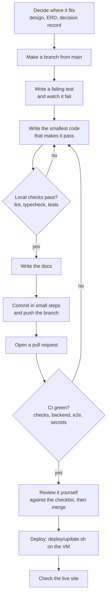

# Developing a feature by hand: the workflow

The procedure for taking a change from idea to production without an AI agent, with worked examples of each kind of test and what every CI job needs. It is the "how"; the reference pages stay where they are: [testing.md](testing.md) (commands and helpers), the [test strategy](../testing-strategy.md) (which layer when), [engineering.md](../engineering.md) (principles), [maintaining.md](maintaining.md) (day-to-day and production).

## 1. The whole path



## 2. Step by step

### 2.1 Decide where it fits (before any code)

- **Does it change what the product does?** Read the matching section of the [design](../superpowers/specs/2026-11-11-kwnto-design.md) and change its text first. The design is the approved source of truth; code that disagrees with it is a bug in one of the two.
- **Does it change the data?** A new collection or field needs a migration in `backend/pb_migrations/` (with its **access rules**, deny by default), a rule test, and the [ERD](../superpowers/specs/2026-11-11-kwnto-erd.md). The steps are in `AGENTS.md`, "Adding a collection".
- **Does it need a new dependency?** It needs a decision record in `docs/decisions/` first (copy the shape of `0005-export-libraries.md`) and your explicit decision. The PR checklist enforces this.
- **Keep it small.** Change only what the feature needs ([engineering.md](../engineering.md) section 3). If you spot an unrelated problem, note it and fix it in its own branch.

### 2.2 Branch

Work on a branch named by what it is: `feat/<what>`, `fix/<what>`, `docs/<what>` (the repo's history uses these). Never commit to `main`.

```sh
git switch main && git pull
git switch -c feat/my-feature
```

### 2.3 Test first, then code

Write the test that describes the behaviour, run it, and check it **fails for the right reason** (the feature is missing, not a typo). Only then write the code. Section 3 says which kind of test, and section 4 shows how to write each.

### 2.4 Rules every change follows

Enforced by lint where marked:

- Only `frontend/src/backend/` imports PocketBase (lint).
- 300 lines per file (lint). No `any` without a comment saying why (lint).
- Text from people (titles, lines, labels, comments) is drawn as React text. Never `dangerouslySetInnerHTML` (lint). Write a test with HTML in the text, as `e2e/player.spec.ts` does.
- Access is enforced by the **server** (rules and hooks), never only in the browser.
- Settings (limits, timings) live in the settings tables, not in code.
- A change to existing behaviour keeps its existing tests. **Never edit a failing test to make it pass**; if a test fails for a reason you did not expect, stop and find out why.

### 2.5 Check locally, fast first

| When | Run | What it covers |
|---|---|---|
| While writing | `npx vitest run <file>` | One unit test file, in a second |
| After a code change | `npm run lint && npm run typecheck && npm run test:unit` | Style, types, all unit tests (about the same as the CI `checks` job) |
| Changed a hook, rule or collection | `npm run test:rules` (or `npm run test:rules -- tests/rules/<name>.rules.test.ts` for one file) | Access rules against a live PocketBase in Docker |
| Changed a screen | `npm run test:e2e -- e2e/<name>.spec.ts --project chromium` | One spec in one browser; drop `--project` for both |
| Before the PR | `npm test` | Everything the CI runs (lint, typecheck, unit, container, rules, e2e). Slow; the e2e part takes the longest |
| Before the PR, **local only** | `npm run check:hygiene -- --base origin/main` and `npm run check:quality -- --base origin/main` | Every new test has its `// Protects:` header, nothing is skipped or focused, no test or assertion was lost, and changed files stay inside the function-length, complexity and nesting limits. **The CI does not run these two**, so nobody will catch a miss for you |

### 2.6 Document it

Section 6 says which file. Write the user-facing wording first: it forces you to settle the exact on-screen text, which the e2e test will then assert.

### 2.7 Commit

- Small commits, one logical change each, with a message that starts with a type: `feat:`, `fix:`, `test:`, `docs:`, `chore:` (as in the history).
- The pre-commit hook runs **gitleaks** on what you stage and blocks a secret. Install gitleaks and run `npm run prepare` once. Never `git commit --no-verify`; if a commit is refused because gitleaks is missing, install it.
- Never commit `.env`, backups or keys. The CI scans the **whole history**, so a secret removed in a later commit is still found.

### 2.8 Pull request

Push the branch and open a PR against `main`. The template (`.github/pull_request_template.md`) has the checklist: tests added and passing, docs updated, existing-code changes explained, no new dependency without a record, `PERF:` comments complete. Fill in **Summary**, **What was tested** and **Risk**. Put `Closes #N` in the description to close an issue when it merges.

### 2.9 After the CI is green

Read your own diff once as a reviewer would. Then merge, deploy with `deploy/update.sh` and check the live site: [maintaining.md](maintaining.md#production-in-short).

## 3. Which test do I write?

| What I changed | Layer | Where it lives | Run with |
|---|---|---|---|
| A function with a decision in it (a comparison, a branch, a limit, a parse) | **unit** | beside the module: `<name>.test.ts` in `frontend/src/` or `scripts/` | `npm run test:unit` |
| The pure part of a server hook, in `backend/pb_hooks/lib/` | **unit** | `tests/hooks/<helper>.unit.test.ts` | `npm run test:unit` |
| A collection, an access rule, a hook or a custom route | **rules** | `tests/rules/<collection>.rules.test.ts` | `npm run test:rules` |
| A screen or a person's flow | **end-to-end** | `e2e/<feature>.spec.ts` | `npm run test:e2e` |
| The Dockerfile, a compose file or a start-up script | **container** | `tests/container/` | `npm run test:container` |
| How something looks, real mail, a real export | **manual** | an `M` item in `docs/test-plan.md` | a person signs off with the date |

A new collection or rule **always** needs a rule test, and `tests/rules/coverage.rules.test.ts` fails if a collection has none (the file name must be exactly the collection name). A rule set to `""` (public) fails that check unless it is listed in `PUBLIC_RULES` with a comment citing the design section that allows it.

## 4. Writing the tests

### 4.1 What every test has

- **A header comment** on the line directly above, no blank line, starting `// Protects:` and saying which requirement or risk it guards. `npm run check:hygiene` rejects a new test without one.
- **A title that states the behaviour**, not the function: `'a member adds a link and the server trims it'`.
- **One behaviour per test.** If the title needs "and" twice, split it.
- **No `.skip`, `.only`, `xit` or `test.todo`**, and no fewer tests or assertions than before (`check:hygiene` rejects all of these).
- **A fresh user per test** in rules and e2e tests (`createUser()`, `uniqueEmail()`); never share accounts. A test that changes a global setting restores it in `afterEach`.
- **Try the awkward cases**: empty, one, huge; capitals and stray spaces; the value after a delete or a reload; the wrong person (outsider, member, signed out); two things at once. The [catalogue](../testing-strategy.md#4-the-catalogue-of-awkward-cases-by-kind) lists them with where each bit us.
- **Prove the test can fail.** Break the code on purpose, run the test, watch it fail, restore the code. A test that stays green when the code is broken protects nothing.

### 4.2 A unit test

A pure function, no server, no browser. This is `frontend/src/backend/subscriptions.test.ts` for `closesQuietly`, shortened a little:

```ts
import { expect, test } from 'vitest'
import { closesQuietly } from './subscriptions'

// Protects design 6.7: closing a live subscription while the connection is down is a normal event. The close request
// fails, and that failure must not escape as an unhandled rejection (callers close without waiting or catching).
test('a close function never rejects, and still runs the real close once', async () => {
  let calls = 0
  const failing = closesQuietly(() => {
    calls++
    return Promise.reject(new Error('network down'))
  })
  await expect(failing()).resolves.toBeUndefined()
  expect(calls).toBe(1)
  // ... and a close that works still works
})

// Protects the same rule for a close that throws at once instead of returning a rejected promise.
test('a close function that throws is also quiet', async () => {
  const throwing = closesQuietly(() => {
    throw new Error('client gone')
  })
  await expect(throwing()).resolves.toBeUndefined()
})
```

Note the pattern: arrange (build the thing with a failing dependency), act (call it), assert (what must hold), and a second test for the neighbouring case. For logic over the editor's data, build state with the helpers in `frontend/src/features/editor/model/fixtures.ts` (`node`, `line`, `connection`, `content`) and `fromContent`, as `story.test.ts` does.

### 4.3 A hook helper test

Server hooks load plain CommonJS helpers from `backend/pb_hooks/lib/`. Put the **decision** in the helper (pure, no PocketBase) and test it in the unit layer, because the hook itself can only be tested against a live server. Load the helper the way PocketBase does (simplified from `tests/hooks/project-file.unit.test.ts`):

```ts
import { createRequire } from 'node:module'
import { expect, test } from 'vitest'

// The hook helpers are CommonJS so PocketBase can require() them; load them the same way.
const require = createRequire(import.meta.url)
const { buildProjectFile } = require('../../backend/pb_hooks/lib/project-file.js') as {
  buildProjectFile: (records: Record<string, unknown>, nowIso: string) => Record<string, unknown>
}
```

Then call the function with plain objects and assert on the result. The hook that uses it is covered by a rule test (next).

### 4.4 A rule test (access, hooks, routes)

Rule tests run against a real PocketBase in Docker and call its HTTP API as different people. They are the most important layer: they are what stops one team reading another's data. Test **every actor** for each operation, in this order: signed out, a signed-in outsider, a member, the owner, and an injection string (it must be treated as data). Shortened from `tests/rules/node_links.rules.test.ts`:

```ts
describe('node_links rules and collection', () => {
  afterEach(async () => {
    const admin = await asAdmin()
    for (const r of await admin.collection('node_links').getFullList()) {
      await admin.collection('node_links').delete(r.id)
    }
  })

  // Protects: a member adds a link and the server trims what it stores (C4)
  test('a member adds a link and the server trims it', async () => {
    const { owner, projectId, chapterId } = await memberProject()
    const nodeId = await createNode(owner, projectId, chapterId)

    const res = await addLink(owner, { project: projectId, node: nodeId, creator: owner.id, title: ' Trailer ', url: ' https://example.com/v ' })
    expect(res.status).toBe(200)
    const data = await res.json()
    expect(data.title).toBe('Trailer')
  })
})
```

The helpers (in `tests/rules/helpers/`): `createUser()` makes a user (verified unless you pass `{ verified: false }`), `asUser(user)`, `asAnonymous()` and `asAdmin()` give an API client for that person, `rawSend(token, path, init)` sends a request and lets you check the status code, and `memberProject()`, `createNode()`, `addMember()` build the setup. `afterEach` cleans the collection so tests do not leak into each other.

**Prove the rule is really tested:** temporarily open the rule (set it to `""` or `@request.auth.id != ''` in the migration), run the test and watch it fail, then restore it. A rule test that passes with the rule open tests nothing.

Run one file with `npm run test:rules -- tests/rules/<name>.rules.test.ts`.

### 4.5 An end-to-end test

A person's flow in a real browser (Chromium and Firefox) against the real app and a throwaway PocketBase. `e2e/editor-offline-errors.spec.ts`, shortened, with the comments added for you:

```ts
import { expect, test } from '@playwright/test'
import { addNodeAt, ownerWithProject, readyCanvas } from './helpers/editor'
import { goOffline, syncStatus } from './helpers/offline'

// Protects design 6.7: losing the connection with a project open is a normal event, so it must not raise an uncaught
// error (...). Found by the M8/M9 walk on 2026-11-26.
test('going offline and back online raises no uncaught error', async ({ page, context }) => {
  const uncaught: string[] = []
  page.on('pageerror', (error) => uncaught.push(error.message))
  await ownerWithProject(page, 'Story')       // sign up, verify, make a team and a project, open it
  await readyCanvas(page, 0)                  // wait until the canvas has drawn
  await addNodeAt(page, 60, 60)
  await readyCanvas(page, 1)

  await goOffline(context, page)              // waits for the "Offline" status
  await page.waitForTimeout(3000)             // the one deliberate fixed wait, explained in the file
  await context.setOffline(false)
  await expect(syncStatus(page).filter({ hasText: 'Offline' })).toHaveCount(0, { timeout: 20_000 })

  expect(uncaught).toEqual([])
})
```

Habits that keep e2e tests reliable:

- **Reuse the helpers** in `e2e/helpers/`: `editor.ts` (`ownerWithProject`, `addNodeAt`, `card`, `connectNodes`, `readyCanvas`, `waitForSave`), `pair.ts` (`ownerAndMember`: two people on one project), `offline.ts`, `share.ts`, `media.ts`, `player.ts`, `export.ts`, and `admin.ts` (make accounts and records through the admin API when the setup is not what you are testing).
- **Never `waitForTimeout`.** Wait for something on the page or the network (a locator, `waitForSave`, a status). The exception is proving that something does **not** happen, which has no event to wait for; keep that wait short and say why in a comment, as above.
- **For "X is absent", first wait for a positive signal** that the screen has loaded, or the check passes before the data arrives. Use `toBeEnabled()` for a gate, not `toBeVisible()`: a disabled button is visible.
- **Use roles and test ids**, not CSS classes: `getByRole('button', { name: 'Play' })`, `getByTestId('node-card')`.
- **Assert the exact copy** the person sees (`'This choice isn't linked to a node yet.'`), taken from the docs you wrote first.
- **A node outside the view is not in the page.** The canvas draws only what is visible; pan or search to a card before clicking it.
- **Click a card's header** (`click({ position: { x: 30, y: 12 } })`), not its middle: a card with media shows tiles that open the media viewer.
- When a test fails, open `test-results/<test>/error-context.md`: it is the page as text at the moment of failure. For more, run with `--trace retain-on-failure` and open it with `npx playwright show-trace <trace.zip>`.

## 5. What each CI job needs

The workflow is `.github/workflows/ci.yml`. It runs on every pull request and on pushes to `main`. All four jobs use Node from `.nvmrc` and `npm ci`. It never deploys; deploying is `deploy/update.sh` by hand.

| Job | It runs | It needs | Reproduce locally | Usual reasons it fails |
|---|---|---|---|---|
| `checks` (about 3 min) | `npm run lint`, `npm run typecheck`, `npm run test:unit`, `npm audit --omit=dev --audit-level=high` | Nothing but Node | `npm run lint && npm run typecheck && npm run test:unit && npm audit --omit=dev --audit-level=high` | A lint rule (file over 300 lines, `any`, a banned API); a broken relative link in the docs; a type error; a failing unit test; a **high** advisory in a shipped dependency: update it, or record the decision |
| `backend` (about 8 min) | `npm run test:container`, `npm run test:rules` | Docker on the runner (each starts its own throwaway PocketBase) | the two commands | A rule or hook change without a matching test update; a collection without a `<name>.rules.test.ts`; a rule set to `""` not listed in `PUBLIC_RULES`; a Docker or compose change that breaks the hardening tests |
| `e2e` (about 30 min) | `npx playwright install --with-deps firefox chromium`, then `npm run test:e2e` | Docker, both browsers, ports 5174 and 5175 free | `npm run test:e2e` | A real regression; or a timing flake (see 8). On failure the run uploads `playwright-report/` as an artifact for 30 days (open the run on GitHub, "Artifacts") |
| `secrets` (seconds) | gitleaks over the full git history | Nothing | `gitleaks detect` (`gitleaks git` in newer releases) | A key, password or token anywhere in any commit of the branch |

What the CI does **not** check: `check:hygiene` and `check:quality` (run them yourself, section 2.5), anything on the manual sign-off list (look and feel, real mail), the live site, and whether your docs are *good* (only that their links resolve).

## 6. Where the documentation goes

| Who needs it | Where |
|---|---|
| A person using the app | `docs/user/`: add to the matching guide (`editor.md`, `sharing.md`, `accounts-and-teams.md`, `player.md`) or a new file. Plain words, the exact on-screen copy |
| You as the admin (a setting, a script, a deployment step) | A new setting in the table in `docs/admin/settings.md`; an operations or deployment change in `docs/admin/deployment.md` |
| Whoever changes the code | `docs/developer/`: `editor.md` (editor and canvas), `backend.md` (hooks, collections, the door), `project-file.md` (import/export format), `styling.md` (tokens), or a short new section |
| A dependency or a choice with real trade-offs | A new numbered file in `docs/decisions/` |
| A security-relevant change (new input, new access rule, an accepted risk) | `docs/security.md`, matching section; accepted risks in section 10 |
| What the product now does, or its data | The [design](../superpowers/specs/2026-11-11-kwnto-design.md) and the [ERD](../superpowers/specs/2026-11-11-kwnto-erd.md) |
| That it is tested | A row in `docs/test-plan.md` (layers, test files); an `M` item if a person must check something by hand |

New pages must be linked from somewhere (a README or the guide that fits); `npm run check:docs` fails on a broken relative link, not on an orphan page.

## 7. Before you merge your own PR

- [ ] A failing test existed first, and I saw it fail; each new test has its `// Protects:` header, and `check:hygiene` and `check:quality` pass (the CI does not run them).
- [ ] `npm test` passes locally, or at least the layers my change touches, and the CI is green.
- [ ] Docs updated (section 6), including the exact on-screen wording and the test-plan row.
- [ ] I read my own diff: no stray debugging, nothing unrelated, no file over 300 lines.
- [ ] No secrets, no new dependency without a record, existing tests untouched or deliberately changed with a reason in the PR.
- [ ] I know how to undo it: the PR can be reverted, and `deploy/update.sh` has made a backup.

## 8. When a test fails

- **Read the failure first.** An e2e failure leaves `error-context.md` (the page as text) and optionally a trace; a rule or unit failure prints the expected and received values.
- **Decide: bug or flake?** Run the one failing test alone, then repeat it (`--repeat-each 10 --workers 4`). Fails every time: a real bug, fix the code. Passes alone, fails in the full run: look for contention (a slow start, a shared setting) before changing anything.
- **Reproduce before you fix.** For a timing flake, load the machine on purpose (busy loops on every core) and show the test failing; after the fix, show it passing under the same load. A fix you cannot demonstrate is a guess.
- **Known slow start:** in busy full runs Firefox sometimes holds a project on "Loading project…" for 5 seconds or more (issue 26). Setup steps wait 15 seconds (`SETUP_TIMEOUT_MS` in `e2e/helpers/ui.ts`). A single Firefox failure at a setup step: run that spec again.
- **A run that will not start:** "port 5174 is already used" means a web server from an interrupted run is still there; stop it. A leftover test container: `docker compose -f compose.test.yaml down -v`.
- **Never** edit a failing test to make it pass, add `.skip`, or widen a timeout to hide a real bug.
