# KWNTO Database ERD

Companion to [2026-11-11-kwnto-design.md](2026-11-11-kwnto-design.md), section 9c. PocketBase on SQLite (relational). Status: draft for approval.

## Diagram

```mermaid
erDiagram
    users ||--o{ team_members : "joins as"
    teams ||--o{ team_members : "has"
    users ||--o{ teams : "owns"
    teams ||--o{ projects : "contains"
    projects ||--o{ chapters : "organized into"
    chapters ||--o{ nodes : "contains"
    nodes ||--o{ script_lines : "has"
    nodes ||--o{ cues : "has"
    nodes ||--o{ media : "has"
    nodes ||--o{ comments : "has"
    users ||--o{ media : "uploads"
    users ||--o{ comments : "writes"
    projects ||--o{ connections : "has"
    nodes ||--o{ connections : "from"
    nodes ||--o{ connections : "to"
    projects ||--o| nodes : "start node"
    projects ||--o{ share_links : "shared by"
    users ||--o{ share_links : "creates"
    projects ||--o{ path_events : "records"
    connections ||--o{ path_events : "chosen in"
    teams ||--o{ team_invites : "sends"
    users ||--o{ team_invites : "receives"
    users ||--o{ security_events : "involved in"
    teams ||--|| team_settings : "configured by"
    users ||--o| user_preferences : "prefers"
    users ||--o| user_limits : "limited by"
    users ||--o| user_status : "status"
    projects ||--|| project_settings : "configured by"
    nodes ||--o{ presence : "being edited"
    users ||--o{ presence : "editing"

    users {
        string id PK
        string email
        string password "hashed, built in"
        string name
        datetime created
    }
    teams {
        string id PK
        string name
        string owner FK "users"
        datetime created
    }
    team_members {
        string id PK
        string team FK
        string user FK
        string role "owner or member"
        datetime created
    }
    projects {
        string id PK
        string team FK
        string name
        string start_node FK "nodes, nullable"
        datetime deleted_at "trash, nullable"
        datetime created
        datetime updated
    }
    chapters {
        string id PK
        string project FK
        string title
        number position "tab order"
        datetime deleted_at "trash, nullable"
    }
    nodes {
        string id PK
        string project FK "denormalized"
        string chapter FK
        string title
        string color
        number x
        number y
        number height
        datetime deleted_at "trash, nullable"
        datetime created
    }
    script_lines {
        string id PK
        string project FK "denormalized"
        string node FK
        string character "optional"
        text text
        number sort_order "decimal"
    }
    cues {
        string id PK
        string project FK "denormalized"
        string node FK
        string type "audio, lighting, other"
        text text
        number sort_order "decimal"
    }
    media {
        string id PK
        string project FK "denormalized"
        string node FK
        string uploader FK "users"
        file file
        string kind "audio, video, image"
        number size_bytes "drives quota"
        datetime created
    }
    connections {
        string id PK
        string project FK
        string from_node FK
        string to_node FK "any chapter"
        string label "optional choice text"
    }
    comments {
        string id PK
        string project FK "denormalized"
        string node FK
        string author FK "users"
        text body
        datetime created
    }
    share_links {
        string id PK
        string project FK
        string created_by FK "users"
        string token "random, unguessable"
        string permission "view, comment, edit"
        string kind "live or snapshot"
        bool revoked
        json snapshot_data "snapshot only"
        datetime created
        datetime updated
    }
    path_events {
        string id PK
        string project FK
        string connection FK
        string session_id "random, anonymous"
        datetime created
    }
    presence {
        string id PK
        string project FK "denormalized"
        string node FK
        string user FK
        string field "which attribute"
        datetime updated "heartbeat, expires"
    }
    team_invites {
        string id PK
        string team FK
        string invited_user FK "users"
        string invited_by FK "users"
        string status "pending, accepted, declined"
        datetime created
    }
    team_settings {
        string id PK
        string team FK "unique"
        string join_code
        bool join_code_enabled
    }
    user_preferences {
        string id PK
        string user FK "unique"
        string theme "light or dark"
        bool minimap_visible
    }
    user_limits {
        string id PK
        string user FK "unique"
        number quota_override_bytes "admin only"
    }
    user_status {
        string id PK
        string user FK "unique"
        bool blocked "admin only"
        string blocked_reason "shown to the user"
        datetime blocked_at
    }
    project_settings {
        string id PK
        string project FK "unique"
        bool analytics_enabled
    }
    security_events {
        string id PK
        string type "sign-in, failure, lockout, reset, invite, admin"
        string user FK "users, nullable"
        string ip
        json detail
        datetime created
    }
    system_access {
        string id PK "single record"
        bool registration_open
        bool lockdown "refuse all sign-ins"
        string lockdown_message
    }
    system_storage {
        string id PK "single record"
        number default_quota_bytes
        number max_video_mb
        number max_audio_mb
        number max_image_mb
        json allowed_types
    }
    system_behavior {
        string id PK "single record"
        number presence_timeout_seconds
        number analytics_retention_days
        number trash_retention_days "default 30"
        number security_retention_days "default 365"
        number max_failed_logins "default 3"
        number lockout_minutes "default 5"
    }
```

## Notes

- **Later, not built in the MVP:** an `activity_events` table (project, actor, action, entity type and id, changes with old and new values, summary, time) for project history, the in-app History panel and restore points. See design section 6.9.

- **`project` on content records.** `nodes`, `script_lines`, `cues`, `media`, `comments` and `presence` also carry a `project` link, even though it could be found through the chapter and node. This is on purpose: PocketBase access rules stay short and fast, and a browser can subscribe to live changes for one project with a single filter. The server sets it, and the app must keep it consistent. **[my call]**
- **Per-attribute editing.** Each editable thing is its own field or record: node fields (`title`, `color`, `x`, `y`) are updated independently, and every script line, cue and connection is its own record.
- **Start node.** `projects.start_node` points at one node, which may be in any chapter. Cross-chapter links are ordinary `connections` rows.
- **Snapshots.** A snapshot link stores a frozen copy of the project's structure and text in `snapshot_data`. It references `media` rows rather than copying files, so it uses no quota. Deleted media shows as "media removed".
- **Quota.** Computed from `media.size_bytes` summed per `uploader`, compared with `user_limits.quota_override_bytes` if set, otherwise `system_storage.default_quota_bytes`.
- **`presence`** rows are temporary. A scheduled job removes rows whose heartbeat has expired.
- **`path_events`** are not written when a signed-in team member is playing.
- **Settings are split by scope and by who may edit them** (design section 7c):
  - `system_access`, `system_storage`, `system_behavior`: one record each, admin only, edited in the PocketBase dashboard. They link to nothing because they apply to the whole system.
  - `user_limits`: one row per user, admin only (quota override). `user_preferences`: one row per user, editable by that user (theme, minimap). They are separate tables because a user may change their theme but not their own quota.
  - `team_settings`: one row per team, editable by the team owner. Joining by code is handled by a server hook, because the person joining is not yet a member and cannot read the table.
  - `project_settings`: one row per project, editable by team members.
  - Rows that should exist (one `team_settings` per team, and so on) are created automatically with the parent record. Typed fields, not key/value, so typos can't silently do nothing.
- **Deleting.** Deleting a project, chapter or node sets `deleted_at` (the trash). Its contents are hidden with it and return when restored. After `trash_retention_days` (default 30) a scheduled job removes the records and media files for good. Trashed media counts toward quota until then. Single lines, cues, comments and connections are removed outright (undo/redo covers them). Deleting a user keeps their comments and media records but removes them from teams **[my call; confirm]**.
